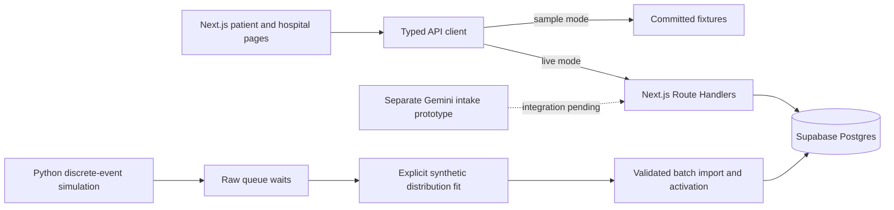
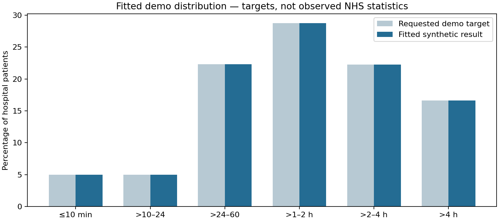

# OxHack · Hospital Comparison & Capacity Simulation

**Helping patients receive care sooner and helping clinical teams make better use of their time.**

Built with **Next.js · React · TypeScript · Tailwind CSS · Supabase Postgres · Python**, with a separate **Gemini intake prototype**.

[Quick start](#quick-start) · [Simulation and results](#how-we-generated-the-data) · [Database](#supabase-data-and-deployment) · [API status](#api-and-integration-status) · [Tests](#verification-and-tests)

> This is a synthetic demonstration, not a clinical triage service. Hospital names are real labels; specialist coverage, staffing, patient records and operating assumptions are invented. The final wait distribution is explicitly fitted to demo targets, not measured NHS performance.

## Why we built it

**Our motivation is time:** the time a patient spends travelling and waiting for care, and the clinical time that can be freed by allocating resources more efficiently.

For a patient, the closest hospital may still mean a longer wait before receiving care. The patient side compares **travel time plus expected waiting time** across hospitals that can handle their complaint, helping them find where they can receive care fastest. A longer journey can be worthwhile when it leads to an earlier doctor assessment.

The clinician side works towards the same goal through **efficient resource allocation**. By understanding demand and the availability of doctors, specialists and beds, clinical teams can identify bottlenecks, explore staffing changes and plan capacity where it is needed. The aim is to reduce delays, free up capacity and make better use of clinicians' schedules.

The intended experience connects these two sides:

- **Patient:** describe a complaint, optionally add an image and pain score, confirm categories, and compare eligible hospitals by the estimated time until care.
- **Clinician:** review demand and resource pressure, then explore allocations that shorten patient waits and use staff time more effectively.

The current comparison measures journey time plus the wait from reception to **first general-doctor contact**. It does not estimate how long completing treatment will take.

This repository contains the application foundation, typed API contracts, comparison logic, reproducible simulations and a deployed synthetic database. The complete patient journey and hospital dashboard are still integration work; real-world time savings have not been measured.

## What we accomplished

| Area | What exists |
| --- | --- |
| Web foundation | Next.js App Router pages for `/`, `/patient` and `/hospital`, shared components, loading/error states and a typed API client. |
| Sample mode | Committed fixtures and an in-memory scenario adapter for offline development, including example capacity changes. |
| Backend | A Supabase-backed catalog and an opt-in comparison route that ranks eligible hospitals by travel plus waiting time, with specialist checks, manual-category handling and an emergency stop. |
| Simulation | A discrete-event model of reception-to-first-general-doctor waits, with resource queues, changing rosters, specialist pathways and support beds. |
| Demand modelling | Unequal hospital catchments, recurring weekday/time-of-day patterns and random variation in arrivals and service durations. |
| Demo calibration | A separately labelled fitted wait model matching the requested distribution, mean and median while retaining raw queue results. |
| Supabase deployment | The latest dataset is imported, activated and independently verified through SQL and the data API. Previous visits and staffing are privately archived. |
| Gemini prototype | A separate branch contains the Express/HTML intake demo, structured-output prompt, validation and request/UI tests. It is not yet integrated into this Next.js checkout. |

**Branch scope:** the application and current data work live on [`zack/demand-pattern-simulation`](https://github.com/Zack-Aftab/oxhack-project/tree/zack/demand-pattern-simulation). This README branch builds on that work. The fork's `main` branch still contains the earlier collaboration scaffold.

## Architecture



The frontend uses one client abstraction for sample and live data. A failed live request is displayed as an error; it is never silently replaced with a fixture.

| Layer | Technology |
| --- | --- |
| Application | Next.js 16 App Router, React 19, TypeScript 5, Tailwind CSS 4 |
| Backend | Next.js Route Handlers in the same application |
| Database | Supabase Postgres, versioned datasets and restricted access |
| Simulation and fitting | Python 3.11+; model scripts use the standard library |
| Import tooling | Node.js scripts, small HTTP batches and a validated activation function |
| Separate intake prototype | Gemini SDK, Express, Multer and an HTML/JavaScript form |
| Runtime | Node.js 24 LTS and npm |
| Deployment target | Vercel for the web app; Supabase for Postgres. A public Vercel deployment is not recorded in this branch. |

## How hospital eligibility works

For this demo, each confirmed complaint category maps to one required doctor type:

| Complaint category | Required modelled specialty |
| --- | --- |
| Fracture, sprain or dislocation | Orthopaedics |
| Cuts or wounds | Wound care / plastics |
| Head injury or neurological symptoms | Neurology / neurosurgery |
| Breathing problems | Respiratory medicine |
| Chest pain or heart symptoms | Cardiology |
| Abdominal or stomach problems | General surgery / gastroenterology |
| Other / uncategorised | General / emergency medicine |
| Unknown | Patient must select and confirm a known category before comparison |

A hospital must support **every required specialty** and have the relevant on-duty capacity. A fracture and a chest complaint therefore require a site covering both orthopaedics and cardiology. Coverage is explicit `true` or `false`; missing capability data is treated as invalid data.

Five hospitals have distinct synthetic specialty mixes. **H001 is the complete-coverage hub**, ensuring that every supported category combination has a capable site. General/emergency medicine uses the general-doctor pool.

After eligibility checks, the implemented comparison ranks sites by:

```text
illustrative travel minutes + rounded-up hospital/urgency-band mean wait
```

Travel times are fixed demo values. Band means are retrospective estimates, with an explicit hospital-wide fallback when a band has no samples. This route does not run a fresh queue simulation for each request.

An explicit emergency flag stops comparison and returns the call-999 action. The bed-support flag is separate: it gives synthetic queue priority and forces stored urgency to `10`, but does not automatically mean an emergency.

## How we generated the data

We developed the model in stages and kept the source, diagnostics and results so the decisions remain reviewable.

### 1. Model the queues and resources

Patients arrive, pass through triage and wait for a general doctor. Required specialist reviews and prolonged support-bed occupancy are also simulated, but the patient-facing wait ends at **first general-doctor contact**.

The model includes:

- On-duty general doctors, triage nurses and specialty-specific capacity.
- Category-dependent consultation work and random lognormal service durations.
- Approximately 5% synthetic bed need and a separate emergency-exit flag.
- Priority for bed-support cases, with an aging allowance among ordinary patients to prevent starvation.
- Nonpreemptive care: a new arrival does not interrupt a consultation already in progress.

Earlier experiments repeated a month five times and stored each patient's rounded-up average. The latest source uses **one fixed month with three warmup days**, followed by an explicit statistical fit. Its estimates are not five-run averages.

### 2. Add recurring demand and randomness

The expected catchment intake averages **450 arrivals per hospital per day across five sites**, with different volumes by site. Specialty matching redistributes those patients, so the final hospital intake can differ substantially from its catchment total.

Demand varies by weekday and four-hour period. Invented patterns include a higher fracture-category weight on Monday mornings and a higher abdominal-category weight on weekend mornings. These patterns illustrate recurring demand; the data does not establish cycling or alcohol as causes.

Poisson arrivals, shared daily variation, hospital-specific variation and random treatment durations make similar calendar periods recognisable without making them identical. Staffing experiments retain the same cohort and random seed for comparison.

### 3. Fit the requested demo distribution

Doctor and bed adjustments alone did not produce the requested wait profile. We therefore added a user-approved **synthetic distribution fit**, separate from the queue engine.

A shared monotone transformation maps raw queue-wait percentiles onto the target distribution. It preserves ordering across patients and hospitals. Within-band curves set the median, and the tail scale sets the mean. The fitted transformation is saved and should remain fixed when comparing capacity changes; refitting every scenario would erase changes in the overall distribution.

Both values are retained:

- `raw_queue_wait_minutes`: the source simulation's actual queue wait.
- `fitted_demo_wait_minutes`: the explicitly calibrated demo estimate.
- `estimated_wait_to_first_doctor_minutes`: the integer ceiling of the fitted estimate.

See the [simulation guide](simulation/README.md), [raw capacity results](simulation/results/distribution-v10/summary.json) and [full fitted-model report](simulation/results/fitted-v11/REPORT.md).

## Results now active in Supabase

The active dataset is **`fitted-v11`**, covering **21 September–20 October 2026**. Its deployment was independently verified on **25 October 2026**.

| Measure | Verified result |
| --- | ---: |
| Modelled hospitals | 5 |
| Hospital patients | 67,473 |
| Separate emergency exits | 203 |
| Fitted mean wait | 120 minutes |
| Fitted median wait | 100 minutes |
| Mean after integer rounding | 120.50 minutes |
| Explicit hospital/specialty coverage cells | 35 |
| Hourly hospital-capacity records | 3,600 |
| Hourly specialty-staffing records | 25,200 |

| Reception → first general doctor | Patients | Percentage |
| --- | ---: | ---: |
| 10 minutes or less | 3,374 | 5.00% |
| Over 10–24 minutes | 3,373 | 5.00% |
| Over 24–60 minutes | 15,069 | 22.33% |
| Over 1–2 hours | 19,425 | 28.79% |
| Over 2–4 hours | 15,028 | 22.27% |
| Over 4 hours | 11,204 | 16.61% |



These percentages are **demo calibration targets**, not evidence of predictive accuracy. The [live verification record](supabase/verification/fitted-v11-live.json) confirms the imported counts, statistics, capability checks, restricted anonymous access and successful REST reads.

[Download fitted results and CSV](downloads/fitted-demo-results.zip)

## Supabase data and deployment

| Relation | Purpose |
| --- | --- |
| `hospitals` | Hospital identities and locations. |
| `specialties`, `category_specialties` | Specialty definitions and category-to-specialty mapping. |
| `hospital_specialties` | Complete explicit capability matrix. |
| `demo_visit_results` | Versioned patient records, including emergency exits, raw queue waits and fitted estimates. |
| `demo_capacity_hours` | Planned hourly general-doctor, triage-nurse and support-bed capacity. |
| `demo_specialist_hours` | Versioned hourly specialty staffing. |
| `simulation_datasets`, `demo_active_dataset` | Dataset metadata, provenance and active-version selection. |
| `visits` | Active hospital-attendance view; excludes emergency exits. |
| `staffing_snapshots`, `specialist_staffing` | Active capacity/staffing views. |
| `hospital_influx` | Arrival counts by hospital and simulation date. |

Previous-hour influx is calculated from arrival records. Planned capacity is distinguished from idle doctors or free beds; unrecorded free-resource telemetry stays `NULL`.

The deployment used a small setup query, **1,000-row upload batches**, and a service-only activation function. Activation validates the complete dataset before switching views. The previous **68,705 visits and 3,600 staffing rows** remain in the private `queuecare_before_fitted_v11` archive.

The database is already populated. Running the app does **not** require reimporting it. Migration/import commands are maintenance operations; see the [database deployment guide](supabase/FITTED-V11.md) before using them.

## Quick start

Use **Node.js 24 LTS**, **npm 10+**, and Python 3.11+ if running the simulations.

```sh
git clone https://github.com/Zack-Aftab/oxhack-project.git
cd oxhack-project
git checkout zack/demand-pattern-simulation
npm ci
cp .env.example .env.local
npm run dev
```

With nvm installed, `nvm use` selects the version in `.nvmrc`. Open <http://localhost:3000>; `/patient` and `/hospital` show the current application shells.

### Sample mode

The default setting is:

```dotenv
NEXT_PUBLIC_DATA_MODE=sample
```

No database credential is required. The sample adapter supports the committed examples and keeps scenario state within one browser tab. It does not synchronise changes between browsers.

### Supabase-backed mode

Set server credentials privately in `.env.local` or the deployment's secret settings:

```dotenv
NEXT_PUBLIC_DATA_MODE=live
SUPABASE_URL=https://<project-ref>.supabase.co
SUPABASE_SECRET_KEY=<server-side-secret-key>
SUPABASE_DATASET_ID=fitted-v11
```

The server also supports the legacy `SUPABASE_SERVICE_ROLE_KEY`. Never give either key a `NEXT_PUBLIC_` prefix or commit it. `SUPABASE_ACCESS_TOKEN` is only for management/deployment operations, not normal application requests.

**Current integration gap:** the catalog honours `SUPABASE_DATASET_ID`, while the multi-category reader still selects `specialist-v7` in code. It must be pointed at `fitted-v11` before that endpoint uses the latest estimates. Enabling live mode alone does not complete the dashboard, classifier or scenario routes.

See [setup instructions](docs/SETUP.md) for individual checks and deployment guidance.

## API and integration status

| Endpoint / feature | Status in this checkout |
| --- | --- |
| `GET /api/catalog` | Implemented against Supabase; dataset selected through server configuration. |
| `POST /api/compare/multi` | Implemented opt-in contract, eligibility checks and emergency/manual-category actions; latest-dataset selection remains to be wired as noted above. |
| `POST /api/compare` | Typed client and sample adapter exist; Route Handler is not implemented here. |
| Scenario dashboard and capacity updates | Sample responses/client methods exist; live Route Handlers are not implemented here. |
| `POST /api/classify` and destination intentions | Proposed client interfaces; not implemented as Next.js handlers here. |
| Full patient journey and five-tab hospital dashboard | Designs and foundation shells exist; full UI integration remains outstanding. |

Shared contracts live in [contracts/queuecare.ts](contracts/queuecare.ts) and [contracts/multi-compare.ts](contracts/multi-compare.ts), with matching fixtures and [interface documentation](docs/INTERFACES.md).

### Separate Gemini intake prototype

The [`codex/gemini-intake-server` branch](https://github.com/Zack-Aftab/oxhack-project/tree/codex/gemini-intake-server) contains `server.mjs`, `public/index.html`, the prompt/schema and validation code. It accepts a description, an optional image and a pain score, validates structured Gemini output, requests clarification when needed and presents an app-owned emergency message.

It runs as a standalone Express application, does not save to Supabase, and is not merged into this Next.js app. Its tests use mocked Gemini responses; model accuracy and a real Gemini request were not verified in that branch's recorded checks. Follow its [demo setup guide](https://github.com/Zack-Aftab/oxhack-project/blob/codex/gemini-intake-server/DEMO-SETUP.md) to run it.

## Verification and tests

```sh
# Application: lint, TypeScript, unit tests and production build
npm run check

# Simulation, hourly capacity, fitted distribution and record integrity
python3 -m unittest discover -s simulation/tests -v

# Import preparation, authentication failures and activation sequencing
node --test simulation/tests/import_fitted_v11.test.mjs
```

At this README review, the checks passed with **20 application tests, 17 Python tests and four importer tests**, plus lint, type checking and the Next.js production build. GitHub Actions runs the application checks on pull requests and pushes to `main`; the simulation/importer commands are additional checks.

Database checks also verified preserved backups, valid specialty assignments, bed-flag urgency constraints, restricted anonymous reads and successful service-role access. Local PostgreSQL-compatible PGlite checks exercised repeated imports and activation; the committed live verification records the deployed result.

### Reproduce the published fitted dataset

```sh
python3 simulation/calibrate_distribution.py simulation/input.json /tmp/oxhack-queue-replay --rounds 0 --trials-from simulation/results/distribution-v10
python3 simulation/fit_demo_distribution.py /tmp/oxhack-queue-replay /tmp/oxhack-fitted-replay
```

Choose output directories that do not already exist. The first command replays the selected capacity configuration from stored trials; it does not rerun the entire calibration search. The second fits the declared demo targets. Neither command modifies Supabase.

## Repository map

```text
src/app/                 Next.js pages and implemented Route Handlers
src/components/          Patient/hospital shells and shared UI
src/lib/api/             Typed client, sample adapter and live adapter
src/lib/server/          Catalog, specialist matching and Supabase readers
contracts/               Shared request/response types
fixtures/                Small examples for UI development and contract tests
simulation/              Queue engine, demand model, calibration and import tooling
simulation/results/      Versioned datasets, reports, models and diagnostics
supabase/                Schema preparation, activation, verification and deployment notes
downloads/               Generated CSV/report bundles and SQL exports
docs/                    Setup, dataset review, interfaces and team build plans
.github/workflows/       Application CI
```

## Next steps

- Connect the application readers and UI to the active `fitted-v11` dataset and multi-category comparison.
- Integrate the Gemini prototype into Next.js with one agreed request/response contract.
- Implement persisted scenario changes and destination intentions across browsers.
- Complete the patient flow and hospital dashboard.
- Build demand forecasting with chronological backtesting and reproducible error metrics; recurring synthetic patterns are not a validated forecasting model.
- Verify the complete flow on a shared deployment and presentation devices.

## Team and collaboration

Built by [Zack-Aftab](https://github.com/Zack-Aftab), [ajjarm](https://github.com/ajjarm) and [smsfm598](https://github.com/smsfm598).

[AGENTS.md](AGENTS.md) records the working agreement. [docs/WORKING-TOGETHER.md](docs/WORKING-TOGETHER.md) covers collaboration, and [docs/build/START-HERE.md](docs/build/START-HERE.md) links the handoff and build plans. Some planning documents predate the implemented simulation and live import; use the code, versioned reports and verification records for current evidence.
