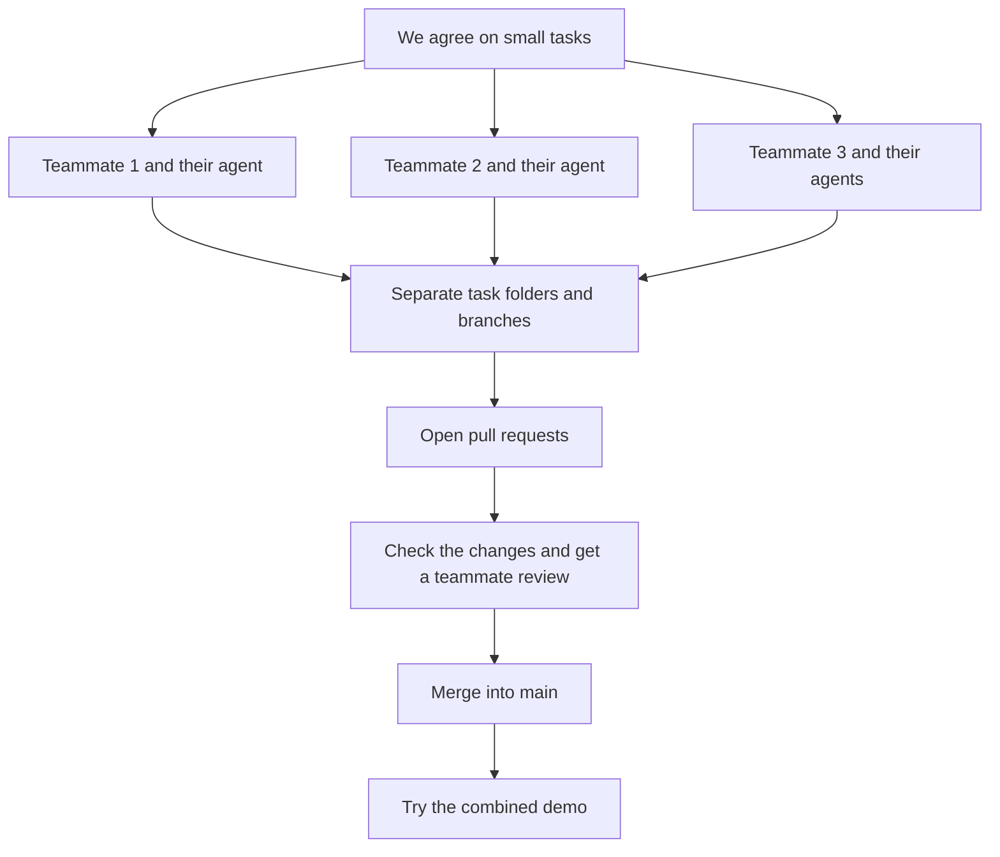

# Our OxHack project 🚀

One project. Three people. Everyone can use their own coding tools and work at the same time.

**Start here:** QueueCare is our synthetic hospital-comparison and capacity-scenario demo. The shared instructions, API agreement and frontend samples are ready. The application still needs to be built.

**Building QueueCare now?** Read the [shared API agreement](docs/INTERFACES.md), use the [small frontend samples](fixtures/queuecare/README.md), and check the [short dataset review](docs/DATASET-REVIEW.md). The application and API routes still need implementing.

## Our team

| GitHub account | Coding tools |
| --- | --- |
| [ajjarm](https://github.com/ajjarm) | Codex and Claude Code |
| [smsfm598](https://github.com/smsfm598) | Gemini |
| [Zack-Aftab](https://github.com/Zack-Aftab) | Codex and Gemini |

Between us we use Antigravity, Codex and Claude Code. Everyone can choose the tool that helps with their task.

## Read these when you need them

- **[Joining for the first time?](docs/JOIN-THE-TEAM.md)** Accept your invite and get the files onto your computer.
- **[Ready to build something?](docs/WORKING-TOGETHER.md)** Make your own task folder and work alongside everyone else.
- **[Something confusing or broken?](docs/HELP.md)** Plain-English explanations and safe first steps.
- **[What are we building?](docs/PROJECT.md)** Our product and technical choices.
- **[How do we run the app?](docs/SETUP.md)** The setup commands, once we have chosen a stack.

## How we work together

Each active task gets its own folder and branch. An agent only changes files in its own task folder.

**Yes, all of these agents can run at once.** If you run two agents yourself, give each writing agent a different task folder.

## What these words mean

| Word | Simple meaning |
| --- | --- |
| Repository / repo | The project's files and saved history. |
| Clone | Your local copy of the repo on your computer. |
| `main` | Our agreed, combined version of the project. |
| Branch | A separate line of changes for one task. |
| Worktree | A separate local folder for a task and its branch. |
| Commit | Save a checkpoint in Git. |
| Push | Upload your commits to GitHub. |
| Pull request / PR | Show your changes and ask to combine them into `main`. |
| Merge | Combine the changes. |
| CI | Automated checks that run on GitHub. |

## The six rules to remember

1. **One writing agent per task folder.** Never point two coding agents at the same folder at the same time.
2. **Claim a small task.** Use a GitHub issue so everyone knows who owns it.
3. **Use a task branch.** Keep everyday implementation off `main`.
4. **Talk before changing shared parts.** Especially APIs, database changes, dependencies and configuration.
5. **Check, then review.** Run relevant checks and have a teammate review your PR.
6. **Keep the demo working.** Merge small changes and try the combined result regularly.

Separate folders prevent accidental overwrites. Changes can still disagree when we combine them, so we coordinate and test.

## Our first steps

1. Both invited teammates accept their GitHub invitations.
2. Fill in [the project agreement](docs/PROJECT.md) together.
3. One person creates the smallest runnable app and fills in [the setup instructions](docs/SETUP.md).
4. Everyone tries running it.
5. Split the next tasks and start working in separate folders.

## Instructions for our coding agents

Shared rules live in [AGENTS.md](AGENTS.md). [CLAUDE.md](CLAUDE.md) imports the same rules for Claude Code. Verify that each installed tool has loaded the project instructions.

Copy this into a new task session, filling in the brackets:

> Read AGENTS.md and README.md. My task is [issue number and outcome]. Work in [absolute task folder] on [task branch]. First tell me your actual folder, branch, intended changes and any overlap with other tasks. Then implement the agreed task, run the relevant documented checks and report the real results. Prepare a small PR for teammate review.

## Current setup

- This repository is public.
- Collaboration instructions and GitHub task/PR templates are included.
- Chosen stack: Next.js App Router with React, TypeScript and Tailwind; Next.js API routes; Supabase Postgres; npm and Node.js 24 LTS; Vercel deployment. The application, checks and service connections are not implemented yet.
- We will choose a license together before publishing or submitting the project.

**Need to add someone later?** Follow [the invitation instructions](docs/JOIN-THE-TEAM.md#for-the-repository-owner-adding-someone-later).
