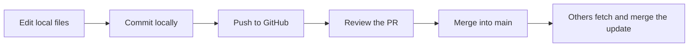

# Help: when we get confused

## I do not know which folder or branch I am using

Ask your agent:

> Do not edit anything. Report your actual working directory, Git branch and current changed files. Is this the workspace for my assigned task?

You can also run `git status` and `git branch --show-current`. From a clone or worktree, `git worktree list` shows that clone's worktree folders.

## Can we all work at once?

Yes. Everyone has their own local clone, and each active writing agent has its own task folder and branch. Review and combine changes through PRs.

If you have both Codex and Claude Code writing, open them in different task folders.

## Why can I not see my friend's new code?

Their local edits are on their computer. They need to commit and push before GitHub has those changes. If their PR is merged, you can bring the updated `main` into your task branch using the update steps in [Working together](WORKING-TOGETHER.md#7-someone-else-merged-while-you-were-working).

## Git says there is a merge conflict

This means Git needs help combining changes. Your work has not automatically disappeared.

1. Do not delete files or choose one side blindly.
2. Tell your agent: "Inspect this merge conflict. Explain both changes and preserve both intended behaviors."
3. Check with the other task owner if the intended behavior is unclear.
4. Check the combined result, commit the resolution and push.

If you want to cancel a merge that is currently in progress, ask your agent to inspect first; `git merge --abort` can return to the pre-merge state.

## Git says a branch is already checked out

That branch is already in use in another worktree in this clone. Use that task's existing folder, or create a different branch for a different task. Do not force a checkout or switch a running agent's branch.

## The app says the port is already in use

Another copy of the app may already be running. Use a different port for each running copy and record the actual commands in [SETUP.md](SETUP.md). Do not stop a teammate's or another agent's process without checking what it is.

## The app needs an environment file or API key

Follow [SETUP.md](SETUP.md). Local `.env` files are ignored by Git and normally do not appear in a fresh worktree. Configure the required values in that workspace. Commit safe example variable names, never real credentials.

## There is no command for running the app

The initial repo contains the teamwork setup. We still need to choose a stack and create the app. The scaffold task must fill in [SETUP.md](SETUP.md) with commands that actually run.

## I cannot open the private repo

Sign into the invited GitHub account and accept the invitation. See [Join the team](JOIN-THE-TEAM.md).

## Are the PR rules enforced by GitHub?

Follow the review agreement in the README. GitHub enforcement depends on the repository's actual settings and plan. Private-repository branch protection requires an eligible plan. A documentation rule alone cannot block a direct push.

## A task is done, but I am worried about deleting its folder

Keep it until its work is committed, pushed and merged or deliberately retained. Ask the agent to check for local-only files. Use `git worktree remove` for a worktree; do not force deletion to silence an error.
