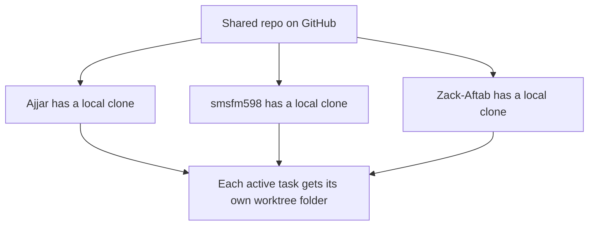

# Join the team

## 1. Accept your invitation

1. Sign in to your own GitHub account.
2. Check your GitHub notifications or the invitation email.
3. You can also open [this repository's invitation page](https://github.com/ajjarm/oxhack-project/invitations).
4. Accept the invitation, then open [the repo](https://github.com/ajjarm/oxhack-project).

This is a private repo. A 404 page can mean you are signed out, signed into the wrong account, or have not accepted the invitation yet.

## 2. Get your own copy

You need Git installed and a way to sign in to GitHub from your computer. Your coding tool can help with this. Each person uses their own account; do not share passwords or access tokens.

If you use GitHub CLI, run `gh auth login` and follow the sign-in steps. Otherwise use your tool's GitHub sign-in or the supported Git credential setup for your computer.

Open a terminal in the directory where you want to keep the project. Run:

```sh
git clone https://github.com/ajjarm/oxhack-project.git
cd oxhack-project
git status
```

This downloads the project onto your computer. Your copy is separate from everyone else's copy.



## 3. Make sure Git knows who you are

If Git asks for a name or email before your first commit, set your own details in the clone. Replace the example values:

```sh
git config user.name "Your Name"
git config user.email "YOUR_GITHUB_COMMIT_EMAIL"
```

Use your GitHub-associated email or the noreply email shown in your GitHub email settings.

## 4. Pick a task

Read the [README](../README.md), agree on a task with the team, and follow [Working together](WORKING-TOGETHER.md).

## For the repository owner: adding someone later

1. Get their exact GitHub username.
2. Open [the repository access settings](https://github.com/ajjarm/oxhack-project/settings/access).
3. Find **Collaborators**, **Collaborators & teams** or **Manage access**, then **Add people**. GitHub's labels may vary.
4. Select the correct account and send the invitation. If GitHub offers a role, choose **Write** for someone who will contribute code.
5. Ask them to accept their invitation while signed into that account.

The two initial teammates are `smsfm598` and `Zack-Aftab`. An invitation only becomes access once they accept it.

## If cloning fails

- Check that you can open the repo in the browser with the same GitHub account.
- Check that you accepted the invitation.
- Sign in again through GitHub CLI or your coding tool if needed.
- Share the error text with your agent, without sharing passwords or tokens.
