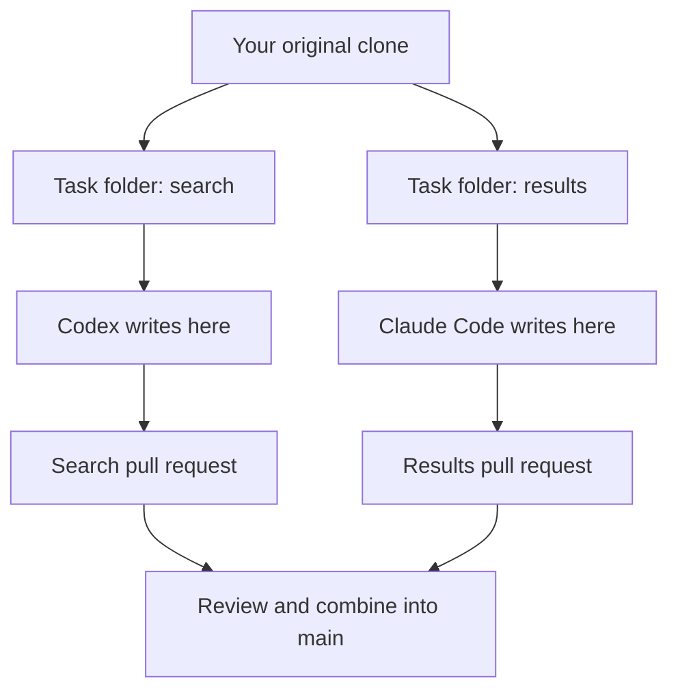

# Working together without getting in each other's way

The rule is simple: **one active task, one branch, one folder, one writing agent**.

Everyone can work at the same time. We review and combine the results in GitHub.

## 1. Agree on a small task

Open the repo's [Issues page](https://github.com/ajjarm/oxhack-project/issues), choose **New issue**, and use the task template.

Give the issue one owner. Write what the user should be able to do, the expected files or components, and how you will show it works. Say if it depends on another task.

If two tasks need to agree on data, record the agreement in [INTERFACES.md](INTERFACES.md). Example: the search box sends a text query, and the service returns a list with specific field names. The UI can use matching sample data while the real service is being built.

## 2. Make a task folder

First open a terminal inside your main clone, `oxhack-project`.

These commands use `alex/search` as an example. Replace `alex` with your name and `search` with your task:

```sh
git fetch origin
git worktree add --no-track -b alex/search ../oxhack-alex-search origin/main
```

What just happened?

- `fetch` downloaded the latest saved history from GitHub. It did not change your files.
- `alex/search` is the new branch.
- `oxhack-alex-search` is the new task folder, beside your original clone.
- The task starts from the latest `main` that you fetched.

Open **that new folder** in your coding tool. Before writing code, ask the agent to report its actual working directory and branch.

## 3. Want two agents running on your own computer?

Create a second worktree with a different task and branch. Run the command from your original clone:

```sh
git worktree add --no-track -b alex/results ../oxhack-alex-results origin/main
```

Now open one agent in each task folder:



You can use Antigravity in a task folder too. The same Git workflow applies.

If your coding tool creates worktrees for you, use that as an alternative to these creation commands. Do not make a new worktree inside an existing task worktree. Some tools start in detached HEAD; create a named task branch before pushing.

Each folder may need its own dependency installation, ignored local environment files and different server port. Separate folders still share any remote services they connect to. Use suitable test data and coordinate database changes.

## 4. Build and check the task

Use [SETUP.md](SETUP.md) for the real app commands once we have chosen the stack.

Tell the team before changing a shared API, database migration, dependency file, lockfile or root configuration that another task needs. Keep unrelated cleanup out of the task.

## 5. Save and upload your changes

Run these inside your task folder:

```sh
git status
git diff
```

Review the files. Check that there are no passwords, API keys or unrelated changes. Then commit the intended files. For example, if your task changed only `docs/PROJECT.md`:

```sh
git add docs/PROJECT.md
git commit -m "Record our demo plan"
git push -u origin HEAD
```

For a code task, replace the file path and message with the ones for your actual change. Your agent can do these steps for the task you assigned it.

## 6. Open a pull request

On GitHub, open a PR from your task branch into `main`. Use the PR template:

- Explain what changed.
- Show what checks actually passed and anything not checked.
- Add a screenshot or example when useful.
- Ask one teammate to review it.

After review and any relevant checks, merge it. We use **Squash and merge** to keep one simple main-branch commit per task. Try the combined demo after meaningful merges.

One person should coordinate overlapping merges at a time. They can still build their own task while doing this.

## 7. Someone else merged while you were working

You do not need to stop just because someone else is working.

When your task needs their latest changes, or before merging your PR, save your current work in a commit. Then, inside your task folder:

```sh
git fetch origin
git merge origin/main
```

Resolve any conflicts with your agent and the other task owner. Run the relevant checks again, then push. See [HELP.md](HELP.md) if Git says there is a conflict.

## 8. Finish the task

After the PR is merged, stop the agent using that task folder. Keep any local files you still need. From your original clone, remove the completed worktree when ready:

```sh
git worktree remove ../oxhack-alex-search
```

If Git says it contains unsaved work, do not force it. Ask the agent to inspect first. For the next independent task, start a fresh branch and folder from the latest `origin/main`.

## Try a practice task first

Each person can create a different `docs/practice/YOUR_NAME.md`, add a sentence, push it and open a PR. Review and merge these before application work. This checks access and the workflow with a tiny change.
