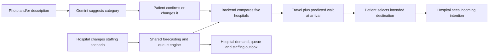

# Build checklist: functional demo and presentation

**25 October 2026. Target: an actual patient-to-hospital demo with explainable ranking and evaluated forecasting.** The backend owner has not pushed code and their contract reply is pending. Tasks below are ready to assign, not claims that any feature already works. Continue fixture UI and data work while that reply arrives.

Roles: **UI = Ajjar using Claude**, **API = Zack**, **Data = third teammate**. Claude owns the one app foundation; Zack extends it rather than generating another. Data owns the forecasting/model module so API is not the bottleneck; Zack owns its integration and persistence. Use [the matching prompts and exact PR handoff](START-HERE.md#exact-ownership-and-handoff). Use the selected Next.js/TypeScript/Supabase stack.

## The demo we are building

An intended destination is not a hospital check-in. Manual category selection remains a working fallback if Gemini fails. Speech-to-text comes last.

## First work block: agree the shared foundation

- [ ] **T01 · All · Start the fixed handoff and API reply.** Send [Zack's prompt](ZACK-START-PROMPT.md) and start [Claude's prompt](CLAUDE-START-PROMPT.md) with patient designs. Claude owns the foundation; Zack owns backend/contracts and backend dependency changes after foundation. Ajjar passes the PR links. Include the extensions in [MODELS-AND-DATA.md](MODELS-AND-DATA.md#backend-changes-to-agree). Check the actual submission deadline and reserve a final demo/rehearsal block. **Done:** everyone knows their branch, files and immediate deliverable; no two agents generate separate app foundations.
- [ ] **T02 · UI · Create/share the runnable app.** Reuse any newer scaffold; otherwise create the agreed minimal Next.js app, patient/hospital routes, typed API client, explicit sample/connected mode, ignored local env and safe env example. Document install/run/check commands in [SETUP.md](../SETUP.md). **Done:** a second teammate can run the same app. Do not wait for final visuals or Gemini.
- [ ] **T03 · Data, with API · Prepare the shared demo data.** Keep the five source hospital IDs and eight category IDs. Import/verify the existing dataset; create small matching API fixtures and a resettable scenario. Add the new forecast, classification, intention and queue examples listed in [the data checklist](MODELS-AND-DATA.md#data-and-fixtures-to-prepare). **Done:** UI and API use identical sample shapes and scenario/version; the original 23 MB file stays off the browser.

T01 coordination and T02 foundation are short shared dependencies. UI design mapping and Data's offline model work can already run alongside them. Once the scaffold is shared, each owner works in their own branch/folder. One writing agent per folder.

## Three parallel work lanes

| Done | Task / owner | What to build | Depends on | Proof it works |
| --- | --- | --- | --- | --- |
| [ ] | **T04 · UI: patient screens** | Implement the supplied patient design: description, optional image preview/remove, category confirmation, origin, compare/results, selection; loading/error/unavailable states. Start with fixtures. | T02, agreed sample shapes | Phone-sized layout completes the sample journey; changing inputs changes the client request. |
| [ ] | **T05 · API: first real comparison** | Catalog, compare, dashboard read and current-window general-doctor update from the existing proposal. Start with its labelled simple model to get a real round trip; preserve source IDs, validate inputs, persist overrides and check stale versions. | T02, T03, contract reply | UI Compare reaches a handler reading shared data; save affects another browser after refresh. This is a checkpoint, not the final technical model. |
| [ ] | **T06 · Data: forecasting engine** | Hourly arrivals/category model from historical visits; chronological backtest against a seasonal baseline; residual ranges and error report. Implement in a shared server-only TypeScript module coordinated with API. | T03; can develop offline during T02 | Forecasts use past-only inputs; held-out MAE and baseline comparison can be reproduced. No invented accuracy percentage. |
| [ ] | **T07 · Data + API: queue and ranking engine** | One reusable queue projection with configurable effective referral capacity. Compare at each hospital's estimated arrival time; apply resource gates, then rank by travel + projected wait. Return explanations/model version. | T06, T05 integration boundary | Same inputs reproduce outputs; zero capacity/missing routes are handled; a staffing change affects both patient and hospital calculations. |
| [ ] | **T08 · API + UI: Gemini intake** | Server-side image + description classification into the eight catalog IDs; user confirmation/change; timeout/error/manual fallback. UI already supports image selection from T04. | T02, catalog; parallel to T06/T07 | Test photo-only, text-only, both, unclear input, unsupported/oversize file, bad provider output and timeout. Keys never enter browser code. |
| [ ] | **T09 · UI + API: connect patient journey** | Swap the typed client to real calls for classification and ranking. Record a destination intention through the backend after explicit selection. | T04, T07, T08; manual category path can connect sooner | No silently substituted samples; refresh preserves the selected intention in the same scenario. |
| [ ] | **T10 · UI: port hospital dashboard** | Use the supplied HTML/design as a visual reference, not an app backend. Replace browser `seed()`, `forecast()`, `pastHours` and business-state localStorage with typed data. Implement all five tabs with the supported metrics below. | T02; fixture rendering in parallel with T04; real bindings need T05–T07 | Hospital selection, windows, sliders, search and save controls operate on the chosen hospital/scenario. Missing metrics are explicitly unavailable. |
| [ ] | **T11 · API + UI: connect incoming/queue actions** | Persist destination intentions separately from checked-in tickets. Add explicit demo check-in/referral/diagnosis events; derive queue aggregates from the same state used by the engine. | T09, T10, agreed event contract | One patient selection creates one incoming intention; check-in creates one queue entry; duplicate requests do not duplicate counts; second browser sees updates. |
| [ ] | **T12 · Data + API + UI: complete predictive dashboard** | Connect forecast/category mix, projected queue/wait, model error, staffing what-if and performance summaries. Replace every remaining fabricated operational claim listed below. | T06, T07, T10 | Horizon changes real returned series; a doctor change recomputes the same model and updates the patient comparison; forecast charts and summary totals reconcile. |

UI can first connect Compare with manual category selection while Gemini is still being built. Data and API should share the pure model function inputs/outputs before writing overlapping files. API imports the model; it must not maintain a second formula.

## What each hospital tab needs

The supplied HTML is a useful interactive prototype. It currently has no fetch calls: localStorage holds staffing, tickets and comments; forecasts and history are generated in JavaScript. Preserve its layout while replacing those sources.

| Tab | Functional target | Small necessary corrections |
| --- | --- | --- |
| **Overview** | Queue count, available ED spaces, expected arrivals, forecast/capacity chart, derived alerts and staffing summary for selected hospital | Replace Marston Road/32 beds/15 per hour constants. The chart labelled “Expected queue” currently plots arrivals: rename it “Arrivals and capacity”, or plot the actual queue series. |
| **Staffing coordination** | Source general/specialist counts; editable general-doctor scenario; server-derived planning target/gap; CSV exports the displayed plan | Prototype General/Trauma/Paediatrics rows do not match the source. Use source roles; no paediatrics field exists. Start with one editable current window; six-window edits need the schedule extension, not six copies of one PATCH. |
| **Demand forecasting** | 24 h then 48 h arrivals, category mix, look-ahead queue/wait, range, capacity warnings and genuine backtest error | Replace sine-wave volumes, fixed percentages, arbitrary ±4 bands and “accuracy” derived from another synthetic curve. Remove fixed “30% redirected × 35 min saved”. |
| **Live queue → Scenario queue** | Incoming intentions separate from checked-in tickets; search/filter, elapsed wait where timestamp is known, staff-controlled demo state transitions | Source has no P1–P5. Remove severity chips/random priority generation for this version; don't have Gemini invent them. Referral/diagnosis are not “in treatment”/“discharged”. |
| **Performance** | Historical referral counts, wait-to-referral, arrival-to-diagnosis, prior-period comparison, hourly source summaries; optional persisted shift notes | Rename length of stay to arrival-to-diagnosis; don't call referral throughput completed treatment. Total/occupied-bed data is missing, so occupancy/utilisation must be unavailable until separately seeded. Feedback is a simple optional extension; disable its save action if not implemented. |

**Rule:** a button either works against its documented source or is visibly unavailable. A pretty chart with unrelated constants does not complete its task.

## Final work block: make it presentable and repeatable

- [ ] **T13 · Data leads, all test · Integration and reset.** Verify the entire journey in two browsers, including refresh, stale update, missing route, zero doctors, classifier failure and no-data states. Use a named scenario and a reset that restores only its synthetic state. Capture code revision, commands, actual outputs and limitations. Verify the public/demo URL on the actual presentation phone/laptop.
- [ ] **T14 · UI + API · Polish and deploy.** Finish responsive layout, loading/retry states and readable explanations. Configure server-side secrets, guarded demo mutations and a shared database. Freeze working code before presentation rehearsal; avoid last-minute dependency changes.
- [ ] **T15 · All · Presentation and demo script.** Prepare problem/user journey, architecture, ranking explanation, forecast method + held-out error, before/after staffing example, limitations and next steps. Rehearse: reset → describe/upload → confirm category → compare/select → hospital incoming list → staffing change → updated prediction/ranking. Keep a short recording/screenshots as an explicitly labelled backup, alongside the functional deployed demo.
- [ ] **T16 · UI + API · Speech-to-text, only after T13–T15 are secure.** Transcription fills the existing description input; the same classification/confirmation flow follows. Test permissions and unsupported browsers; typing remains available.

## What to cut if time gets tight

Keep: patient comparison, confirmed category/manual fallback, shared capacity state, a real forecast with backtest, a common queue/ranking engine, and a rehearsed demo. Reduce: 48 h to 24 h, one editable staffing window instead of six, one demo origin, basic uncertainty ranges instead of Monte Carlo, feedback and decorative panels. Speech-to-text is last. Do not remove technical depth while keeping unsupported claims.

## Start immediately

1. **You:** give Claude the patient design, [starting prompt](CLAUDE-START-PROMPT.md) and this checklist; start T02/T04. Tell API who owns the scaffold.
2. **Backend teammate:** return the pending contract reply, share a branch, and start T05; agree T08/T09/T11 payloads from the proposed extensions before both sides implement them.
3. **Third teammate:** start T03/T06 now, then pair with API on T07 and run T13. Prepare the forecast evidence for the presentation while the UI is being built.

Use task IDs in issues/PRs. Update completion against tested behavior, not generated files. [The technical plan](MODELS-AND-DATA.md) gives the model, sample-data and contract details.
