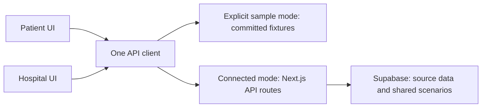
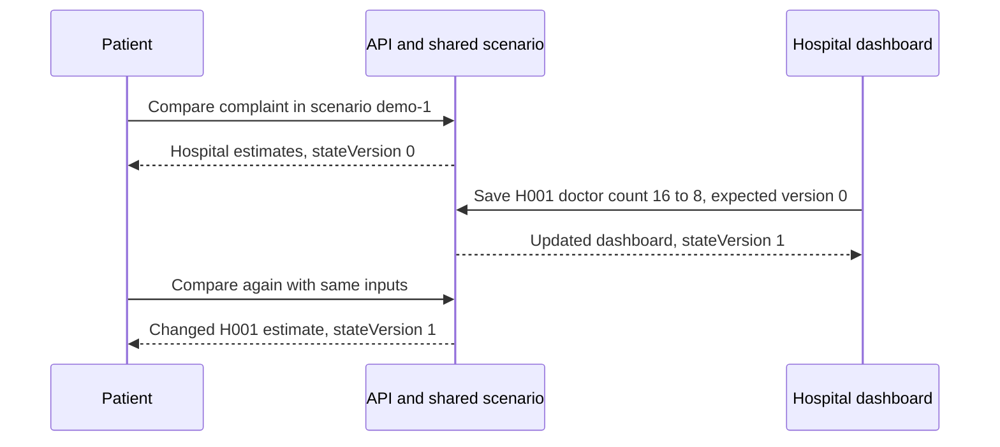

# Product scope

## The idea and the first version

A patient uses a phone to compare simulated hospital options. A hospital user explores a staffing change and sees its effect on the **same** patient comparison. Build one responsive web app; a Swift/native app is outside the first milestone.

The selected stack is Next.js App Router, React, TypeScript and Tailwind; Next.js Route Handlers; Supabase Postgres; npm and Node.js 24 LTS; Vercel. This is a decision, not an installed scaffold. Pin compatible dependency versions and document real commands during setup. Do not introduce a separate Express service just because one appears in an experimental chat snippet.

The app has no product name. `queuecare` filenames and `queuecare.v1` currently identify the dataset/proposed schema; do not mass-rename them or invent a brand.

## Build these small journeys in order

| ID | User can… | Completion check |
| --- | --- | --- |
| P1 | Choose a demo complaint and starting point, then compare hospitals on a phone | All five fixture hospitals render from returned data, with match status, travel, simulated wait to referral and total. Form changes drive a request through one API client. |
| P2 | Understand missing data and request failures | Loading, validation, no-match/unavailable, unknown complaint, missing travel, and retry states work. Unknown values never display as zero. |
| H1 | View the same scenario on a hospital dashboard | Hospital IDs, simulation clock, scenario/version, queues and capacity correspond to patient data. Historical arrivals are labelled historical. |
| H2 | Change a hospital's general-doctor count and compare again | A saved server-side scenario override updates dashboard and comparison consistently; another browser sees it after refresh/Compare. Stale saves show a conflict and refresh option. |
| P3 | Upload a photo and/or describe the problem, confirm the category, and select an intended destination | Server-side Gemini suggests an exact catalog category; user can change it; selection appears as an intention on the hospital side, separate from check-in. |
| F1 | Explore hospital demand and capacity with an evaluated forecast | Historical-data forecast, category mix, projected queue/wait and staffing what-if use the same engine as patient ranking; chronological evaluation versus a baseline is reproducible. |

Start with **P1 and P2 in explicit sample mode** using the exported patient designs. Connect the first real comparison as soon as available, before polishing all screens. Complete P3/H1/H2/F1 through the parallel lanes in [BUILD-PLAN.md](BUILD-PLAN.md). A working sample UI completes the first UI milestone; it does not complete connected integration or the final demo. The simple v1 fixture formula is an early checkpoint; shared time-dependent ranking and evaluated forecasting are required technical work in the expanded demo.

## What the UI means

- Use the exact category IDs, units, error shapes and identifiers in the proposed [contract](../INTERFACES.md), pending backend agreement. Never substitute a display label for an ID.
- Minutes are minutes; timestamps carry offsets; IDs are strings; `null` means unavailable. Preserve `H001`–`H005`.
- Show a visible synthetic-data notice. Travel fixtures are invented demo travel; waits use an illustrative model. These are not current hospital estimates.
- Referral is not proof a doctor has seen the patient. Travel plus wait to referral is separate from arrival-to-diagnosis time.
- The frontend displays the backend's estimates and ordering; it does not develop a second ranking formula.
- Category selection is sufficient for the first P1 checkpoint. Photo/description intake and data-backed forecasts are now required follow-on work, with contracts still to agree. Speech-to-text comes last. Do not make decorative controls appear functional or fabricate unsupported scores.

The expanded demo includes assisted intake, confirmed category and richer hospital demand views. A category suggestion requires user confirmation/change; it is not a diagnosis or clinical-priority score. Native apps and live hospital feeds remain outside this build. Real routing is optional; explicit demo travel can support the complete flow. Intended destination is not a confirmed hospital arrival. See [MODELS-AND-DATA.md](MODELS-AND-DATA.md) for ranking, forecast evaluation and the missing source fields that require small dashboard label/control changes.

## How the pieces fit

Components use one typed client, suggested location `src/lib/api-client.ts`. Sample mode returns fixtures; connected mode calls same-origin `/api/...`. Use an explicit mode setting; a failed real request must show an error rather than silently switching to samples. Keep raw visits, database access and credentials out of browser components.

Both API and UI normally run in the same Next.js app on each developer's computer. A teammate's `localhost` is their laptop, not yours. For a phone demo, use a reachable shared deployment or a deliberately configured local-network URL. Record actual commands/URLs in [SETUP.md](../SETUP.md) once the scaffold exists. Separate laptops sharing changes must use the same configured database/scenario; sample mode cannot prove synchronization.

## Who changes which files

These are proposed paths for the first scaffold, not existing folders. Inspect newer code before creating them.

| Owner | Files / responsibility |
| --- | --- |
| Frontend: user | Patient and later hospital pages/components, styling/assets, typed API client; e.g. `src/app/(patient)/`, `src/app/(hospital)/`, `src/components/`, `src/lib/api-client.ts` |
| Backend/database teammate | `src/app/api/`, server integration, Supabase schema/migrations/import, shared scenario state and classifier route; coordinate the model boundary with Data |
| Third teammate | Data verification, fixtures, forecasting/model module (suggested `src/lib/server/models/`) and end-to-end checks; coordinate its function inputs/outputs and contract changes with API |
| One named owner at a time | Root scaffold, package/lock files, layout/global CSS, environment examples, deployment/CI and contract changes |

Recommendation: the frontend owner makes the first minimal Next.js scaffold because patient work is starting now. Tell the backend owner before starting so they extend that scaffold rather than generating another app. If they already made one, reuse it. After the foundation is shared, everyone works on separate branches/folders in parallel. See [WORKING-TOGETHER.md](../WORKING-TOGETHER.md) for save, push, review and merge steps.

## First connected milestone

For the initial simple model only, the fixture expectation is H001 wait **97 → 193 minutes**, total **121 → 217**; other hospitals stay unchanged. The expanded shared engine needs regenerated fixture expectations and a model identifier. Update contract/model notes and fixtures before asserting new numbers. Do not call fixture switching an end-to-end backend test.

Test the loop in two browsers against the same scenario. Also check failed requests, unavailable values, zero doctors and a stale version save. Record actual results and the database/environment used.

## Decisions needed now, and what can wait

**Now:** designate the one scaffold owner; backend owner confirms/revises the four routes and sample shapes; agree the simulation clock, wait/model meanings, demo travel and shared scenario storage. Decide access controls before enabling a publicly writable capacity route. UI fixture work can proceed while these are resolved.

**Required after the first comparison:** photo/description categorization with confirmation, shared queue/ranking model, evaluated demand forecasts and supported hospital metrics. **Later:** final name, speech-to-text (last), real routing, automatic realtime, Monte Carlo refinements and native packaging. Do not delay P1 for these later refinements.

## Next actions, in order

Follow [the ordered build checklist](BUILD-PLAN.md) for current tasks, parallel owners, model/data work, integration, deployment and presentation. It supersedes the earlier recommendation to defer all forecasting/photo work. The backend reply is still pending; no new API shape is agreed by this scope update alone.
