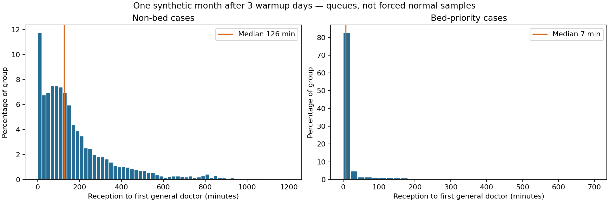

# Revised demand simulation — one run

One stochastic 30-day month (21 September–20 October 2026), after three warmup days. Seed 20261027. No reruns were selected. All operating profiles and patterns are invented, not measured NHS service information. The endpoint remains reception to first general doctor, including triage. No live Supabase tables were changed; this is a separate evaluation artifact, not an activated API dataset.

## Actual result, including missed target

67,676 measured patients generated; 203 synthetic emergencies exit to call 999; 67,473 enter hospital queues. Expected intake is 2,250/day across five catchments (450/site/day on average), not 450 at each final destination. The realised generated mean is 451.2/site/day, including emergencies. Specialty matching redistributes demand to eligible sites and concentrates arrivals at the full hub.

| Group | Mean minutes | Median minutes | 90th percentile |
|---|---:|---:|---:|
| All hospital cases | 176.6 | 119.6 | 420.5 |
| Non-bed cases | 184.6 | 125.7 | 430.6 |
| Bed-priority cases | 28.4 | 7.3 | 74.3 |

84.9% of non-bed cases wait over 30 minutes; 82.8% of bed cases wait under 20 minutes. 3,459 generated patients have bed flags (5.11%), including nine emergency exits. There are no non-bed hospital cases with urgency 8 or above.

The overall median is approximately two hours, but the mean is **176.6 minutes**, exceeding the requested roughly two-hour mean. The 95th percentile is 563.4 minutes and maximum 1,180.5 minutes. This remains a long-tailed distribution, not a normal distribution. H003's small, poorly timed roster produces excessive congestion. Expected-flow staffing calibration misses random backlog and service variation at high utilisation. The model is therefore a demonstration of capacity pressure, not a validated two-hour average. Fixing that target needs another explicitly identified staffing revision and validation run; these results have not been relabelled or clipped.

## Changes and weights

- Bed cases stay at stored urgency 10, with a separate queue class displayed as priority 15. They are always selected before ordinary patients when a resource becomes available. Work already in progress is not interrupted. This separate class is equivalent to priority above 10; it does not change urgency's database range. Bed need does not imply an emergency exit.
- Non-bed urgency follows a truncated normal around 3, adjusted by 0.12 per pain point above 3, standard deviation 0.95, bounded 1–7.5. Ordinary urgency gains one point per two minutes waiting for scheduling purposes; the stored score stays unchanged. This limits a high non-bed score's ability to overtake an older patient. No patient wait is sampled from a normal curve or forced above 30 minutes.
- Base catchment factors: H001 1.25, H002 1.00, H003 0.80, H004 0.90, H005 1.05; sum 5. Weekday factors are [0.99,1,1,1,1.04,1.02,0.95], normalised across the measured month. Four-hour arrival shares are [0.08,0.06,0.20,0.24,0.26,0.16].
- Monday 08–12 fracture category weight ×1.8; other weekday mornings ×1.35. Saturday 04–12 abdominal weight ×1.9, Sunday ×1.5. Friday/Saturday early and late head/wound weights ×1.25. These are fictional correlations for the demo: the data does not establish cycling or alcohol as causes.
- Shared city-day, hospital-day and four-hour intensity multipliers have mean-one lognormal variation of 4%, 5% and 4%. Arrivals inside each block follow a Poisson process. Thus similar calendar slots share expected patterns while actual counts differ. Specialist eligibility still takes precedence over ranking.
- Diagnostic/general direct work averages 20 minutes by case mix. An additional 15% of occupied clinician time covers documentation and other duties, giving an overall 23.53-minute mean occupied time. Triage averages 4.5 minutes, each subsequent required specialist consultation 20 minutes, and support-bed hold 12 hours. Service durations are lognormal. Subsequent care is excluded from the first-doctor endpoint.
- General rosters were planned from analytical expected routing and weekly work, without reading realised future patients. A deterministic fluid planner moves whole doctor slots to target site means of 105–140 minutes, preserving at least 1.5% weekly capacity reserve. This is deliberate calibration to the requested demonstration target, not observational evidence. Only one stochastic month was run. Beds target approximately 72% nominal occupancy; specialist pools target 80% workload.

## Site capacity and outcomes

Doctor rosters list simultaneous on-duty counts for 00–04, 04–08, 08–12, 12–16, 16–20, 20–24 local time. Specialist coverage is unchanged from v7: each category requires its mapped doctor type, all selected types must be covered, unknown must be self-categorised, and H001 covers all modelled types. Specialist counts are recorded in summary.json. General emergency medicine uses the general pool.

| Site | Generated catchment/day | Final hospital arrivals/day | General roster | Support beds | Actual doctor utilisation | Mean / median minutes |
|---|---:|---:|---|---:|---:|---|
| H001 | 562.2 | 933.0 | [3, 5, 19, 23, 34, 13] | 33 | 97.8% | 156.5 / 100.1 |
| H002 | 452.7 | 376.7 | [2, 2, 7, 11, 5, 6] | 14 | 96.3% | 127.1 / 94.4 |
| H003 | 363.1 | 202.6 | [3, 3, 2, 5, 6, 3] | 8 | 98.1% | 403.8 / 281.1 |
| H004 | 394.7 | 315.4 | [2, 2, 5, 7, 13, 3] | 12 | 96.1% | 148.2 / 125.2 |
| H005 | 483.2 | 421.4 | [2, 2, 7, 10, 17, 4] | 15 | 97.8% | 177.5 / 143.9 |

## All-case wait distribution

| Wait | Patients | Percentage |
|---|---:|---:|
| 10 minutes or less | 7,702 | 11.4% |
| Over 10–24 minutes | 3,594 | 5.3% |
| Over 24–60 minutes | 8,095 | 12.0% |
| Over 1–2 hours | 14,461 | 21.4% |
| Over 2–4 hours | 17,596 | 26.1% |
| Over 4 hours | 16,025 | 23.8% |



## Reproduce

```sh
python3 simulation/demand_patterns.py simulation/input.json /tmp/new-demand-run
python3 -m unittest discover -s simulation/tests -v
```

The chosen output folder must not exist. The CSV contains one raw wait and its integer ceiling for each hospital patient, not a five-run average; emergency waits are empty. The full compressed cohort, summary and generation metadata are committed under simulation/results/demand-v8. The ZIP includes the CSV, report, summary, metadata and chart. Prior v7 results and API/SQL seed are unchanged. V8 has not been seeded into the API or Supabase; the existing five-sample raw-visit constraint would need a separate agreed migration before importing one-run rows.
